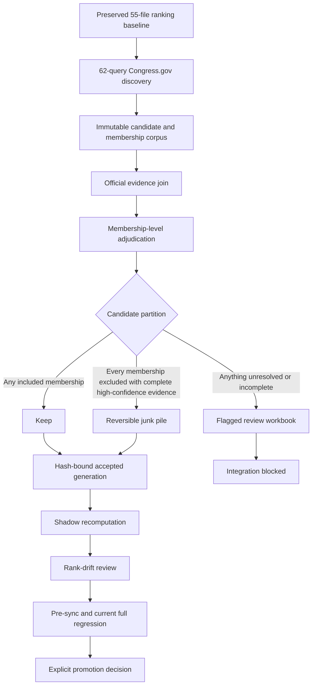

# Legislation culling and corpus-integration architecture

Version: `acu-legislation-culling-integration-v1`

## Objective

Audit all 18,557 discovered candidates and 64,004 candidate/query memberships
without deleting discovery evidence, overcorrecting category relevance, or
allowing an incomplete review into scoring. Congress.gov Advanced Search is
the primary collection instrument. Quorum is a recall floor only and never an
authority for collection, adjudication, or scoring.

## Control flow

The discovery corpus is immutable throughout. Keep, junk, and flagged are
views over the corpus, not destructive moves.

## Evidence envelope

Each candidate receives one `acu-legislation-candidate-evidence-v1` envelope
bound to its original discovery line. The envelope contains:

- canonical Congress/type/number identity and all query memberships;
- discovery path, file hash, and exact record hash;
- official title and its text hash;
- latest nonempty official CRS summary and its text hash;
- accepted official full-text HTML receipt, body hash, exact final URL, typed
  main-surface marker, and challenge checks;
- decompressed-archive rehash and marker-bounded extraction receipt, including
  revalidation of every artifact reused by the resume path;
- a complete official text-version inventory; an absence-based exclusion must
  review every available version, while a localized inclusion may be resolved
  by a specific operative version;
- versioned identifier/keyword results for title, summary, and full text,
  including positive spans and an explicit rule that absence is neutral;
- exactly 19 category audits per candidate, yielding 352,583 candidate-category
  evidence rows and preserving the 64,004 raw query memberships separately;
- actions and derived bill stage, bound to an actions hash;
- sponsor, original cosponsor, later cosponsor, and withdrawn relationship
  edges with Bioguide identity and role provenance;
- source gaps, including an explicitly unavailable CRS summary.

An unexplained missing summary or any missing full text does not become
negative evidence and keeps the membership flagged. When Congress.gov
explicitly has no CRS summary, the envelope records a hash-bound availability
receipt and the decision must rely on official title, purpose/description, and
full text; summary absence itself remains neutral.

## Two levels of culling

Category relevance is adjudicated at the natural key
`(canonical_key, query_id)`. A measure can be a false positive for one query
while remaining relevant to another.

Candidate-wide junk status is stricter. It requires all of the following:

1. Every discovered membership has a final `exclude_false_positive` decision.
2. Every decision cites the official title, CRS summary, and full text.
3. Full-text keyword/identifier rule-out is complete for that membership.
   For an absence-based rule-out, all official text versions are reviewed.
4. Reviewer confidence is high and the decision is human-ratified or an
   officially reverified preexisting decision.
5. No article or press absence is used as exclusion evidence.
6. The exclusion is appended to the hash-chained junk ledger and remains
   separately restorable.

The existing candidate-oriented junk manager is not used to store individual
category exclusions. Membership decisions remain keyed by
§(canonical_key, query_id)§; the candidate junk ledger receives a derived
candidate-wide exclusion only after every membership gate closes.

Any included membership prevents global junk status. Any unresolved or
incompletely evidenced membership is exported to the flagged workbook.

## Artifact boundaries

| Layer | Authoritative artifact | Mutation policy |
|---|---|---|
| Baseline | `audits/legfix5/PRE_LEGISLATION_RANK_CONTROL_2026-07-25.json` | Read only |
| Discovery | `congress_advanced_records.ndjson` and `congress_advanced_memberships.ndjson` | Immutable |
| Official metadata | GovInfo BILLSTATUS parsed records and receipts | Immutable enrichment |
| Official full text | R harvester accepted HTML and receipt trees | Immutable, resumable |
| Candidate evidence | `candidate_evidence.ndjson` | New hash-addressed generation |
| Membership review | `membership_review_ledger.ndjson` | New hash-addressed generation |
| Global junk | Append-only exclusion/restoration ledgers | Reversible only |
| Human review | `flagged_memberships.xlsx` plus NDJSON source | Review surface only |
| Accepted data | `accepted_legislation_relationships.ndjson` | Staged generation only |
| Corpus integration | Approved generation, shadow outputs, and receipts | No production write before terminal gates |

Excel is a review surface, never the sole authority. Every workbook row maps
back to an NDJSON natural key and immutable evidence hashes.

The flagged workbook is generated from the unresolved NDJSON ledger with
these views: §Overview§, §Flagged Memberships§, §Missing Full Text§,
§Ambiguous-Collision§, §Amendment Gaps§, §Legacy Snapshot Audit§, and
§Restored§. Human decision columns are imported only through a validator that
checks natural keys, allowed values, evidence hashes, and duplicate edits.

## Existing evidence reused without new network collection

The join stage must reuse the official, hash-bound evidence already present:

- 14,854 top-level BillStatus measures with official titles, sponsors, actions,
  and role-provenance-complete relationship edges;
- 8,666 usable CRS summaries and 6,188 explicit neutral summary absences;
- 96,603 original-cosponsor events, 107,418 later-cosponsor events, and
  218,875 total relationship rows without collapsing withdrawal/rejoin history;
- 79,736 official actions for the 14,854 top-level measures;
- exact nested BillStatus evidence for 3,461 of 3,703 amendments;
- discovery sponsor and amended-bill identity for the remaining 242 amendments,
  with missing action/stage details kept flagged rather than inferred.

Before the full offline identifier pass, the marker-bounded HTML parser must
match the 109 existing browser-evaluated golden artifacts on semantic fields.
Whitespace-only browser/R text differences do not authorize evidence drift.

The preserved pre-expansion corpus is audited independently: all 465 legacy
bills and 10,986 legacy membership edges must map into the new evidence and
decision ledgers. The earlier 44-bill floor and any 417-row subset are not the
legacy acceptance universe.

## Main-corpus integration

Integration reuses the existing fail-closed sequence:

1. `build_accepted_legislation_generation.py` validates discovery,
   reconciliation, membership decisions, and relationship roles.
2. `assemble_approved_legislation_generation.py` packages only hash-verified
   authoritative inputs in an audit directory.
3. Direction, numeric-plan, and role-method approvals are attached.
4. `run_legislation_shadow_recompute.py` recomputes outside production.
5. Rank deltas are compared with the preserved 55-file baseline. Large or
   unexplained movement blocks promotion; no assumption is made that ranks
   must remain unchanged.
6. Pre-sync, downstream-readiness, formula-cache, role-attribution, and
   current full-regression gates must all pass against the same hashes.
7. Promotion remains a separate explicit action. Passing the architecture
   gate never writes the main corpus automatically.

## Terminal acceptance gates

The executable gate list is defined in
`fec/legislation/legislation_culling_integration_contract.py`. It includes:

- complete registry/discovery/reconciliation and Quorum-floor recall audit;
- completed identifier-probe revalidation;
- independent re-audit of all 465 legacy bills and 10,986 legacy edges;
- accepted full text for every candidate with no unresolved failures;
- decompressed-body revalidation of resumed archives and complete version
  review for every false-positive rule-out;
- 109/109 semantic parser parity and explicit closure of all 3,703 amendments;
- exact membership partition: keep + junk + flagged = 64,004, each exactly
  once, alongside retention of all 18,557 candidate records;
- an exact 18,557-candidate and 64,004-membership evidence partition;
- zero unresolved membership adjudications;
- an audited reversible junk ledger;
- complete stage/action and sponsor/original-cosponsor/cosponsor provenance;
- hash-bound accepted generation and shadow recomputation;
- reviewed rank drift against the preserved baseline;
- current pre-sync and full-regression receipts.

Until all gates pass, the contract reports `BLOCKED` and explicitly records
that scoring, synchronization, promotion, and main-corpus writes did not occur.

## Parallel execution plan

While full-text collection continues, offline workers may safely perform:

- BillStatus title, summary, actions, stage, and relationship normalization;
- evidence-envelope construction for already accepted full-text records;
- membership proposals that remain `unresolved` until ratified;
- incremental flagged-workbook generation;
- junk-ledger integrity audits and baseline drift preparation.

Only the R collector writes full-text artifacts. Only a single coordinator
writes each generation manifest. Workers write disjoint hash-addressed files,
then the coordinator reconciles counts and hashes. This prevents checkpoint
collisions and the corruption seen in the prior oversized/browser workflow.
